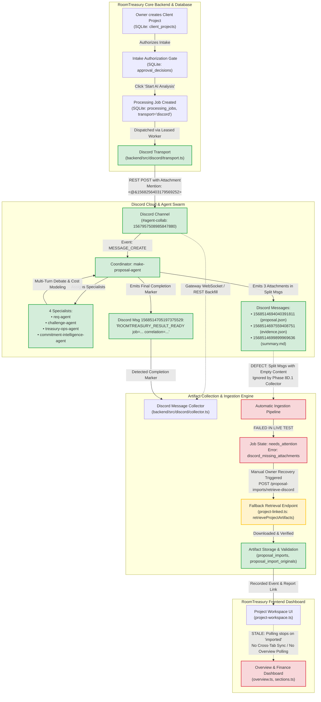
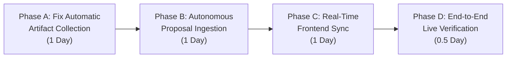

# ROOMTREASURY — INTEGRATION AUDIT & MINIMAL IMPLEMENTATION PROPOSAL

**Document Type:** Technical Integration Audit & Minimal Implementation Proposal  
**Target Platform:** RoomTreasury Core Platform & Multi-Agent Discord Orchestration  
**Status:** Audit Completed · Proposal Staged for Owner Authorization  
**Environment Audited:** macOS / Node.js v22.22.3 / SQLite Local Storage (`./var/demo/northstar-synthetic/roomtreasury.sqlite`)  
**Audit Date:** November 7, 2026  
**Auditor / Engineering Lead:** Antigravity AI

---

## 1. Executive Summary

### 1.1 Current Application Capability

RoomTreasury is a local-first, high-integrity financial and agency operations SaaS platform designed for professional services and digital agencies. The core application provides:

- **Authoritative Intake & Scope Management:** Binds clients, projects, briefs, and tasks (`rt-task-...`) into immutable SQLite records.
- **Strict Financial Safeguards:** Strictly isolates proposed pricing ($1,800.00 / 180,000 cents in synthetic runs) from confirmed agreed revenue (null), approved delivery budgets ($1,075.20 / 107,520 cents), issued invoices, and received cash.
- **Deterministic Job Processing Engine:** Dispatches processing jobs with leased worker execution, retry limits (3 attempts per project), safe timeouts, and comprehensive event telemetry.
- **Discord AI Agent Gateway & REST Bridge:** Authenticates a third-party bot, verifies channel access, dispatches task briefs with coordinator role mentions (`<@&1568256403179569252>`), and maintains a Gateway WebSocket connection with reconnect/resume and REST backfill.
- **Audited Human Review & Approval Gates:** Enforces multi-gate owner review (`scope_alignment`, `internal_rates`, `capacity`, `subcontractors`, `client_terms`, `margin_review`) preventing unreviewed agent proposals from acquiring financial authority.

### 1.2 What Works vs. What Is Missing

| Workflow Stage                            | Operational Status                      | Technical Reality                                                                                                                                                     |
| :---------------------------------------- | :-------------------------------------- | :-------------------------------------------------------------------------------------------------------------------------------------------------------------------- |
| **1. Project Creation & Brief Binding**   | **VERIFIED LIVE**                       | Client project, intake hash, and task binding persist immutably in SQLite.                                                                                            |
| **2. Specialist Task Dispatch**           | **VERIFIED LIVE**                       | Bot dispatches task intake brief with coordinator role mention to Discord.                                                                                            |
| **3. Multi-Agent Discord Collaboration**  | **VERIFIED LIVE**                       | Coordinator and 4 specialists actively converse in Discord for 5–15 minutes.                                                                                          |
| **4. Agent Output File Generation**       | **VERIFIED LIVE**                       | Agents generate 3 genuine files: `proposal.json` (71 KB), `evidence.json` (83 KB), and `summary.md` (4.5 KB).                                                         |
| **5. Automatic Discord File Collection**  | **PARTIALLY WORKING / DEFECTIVE**       | The live background worker failed with `discord_missing_attachments` because attachments were split across sequential messages without text in intermediate messages. |
| **6. Automatic Proposal Import**          | **PARTIALLY WORKING / MANUAL FALLBACK** | Automatic import did not trigger. Files were recovered manually via the authenticated fallback endpoint (`/retrieve-discord`).                                        |
| **7. Financial & Project Record Update**  | **VERIFIED LIVE**                       | Proposal data extracted into `proposal_imports`, `owner_review_revisions`, and `approval_reports`. Financial safeguards blocked spendable activation.                 |
| **8. Real-Time Frontend Synchronization** | **DEFECTIVE / STALE**                   | Workspace poller terminates on non-running states. Overview and Operations pages do not poll or subscribe to events; manual browser reload is required.               |

---

## 2. Existing Integration Inventory

The audit examined all 12 core Discord capabilities, agent orchestration mechanisms, automatic collection pipelines, and frontend synchronization systems against the live codebase and historical database records.

| Integration Item                      | Status                | Test Coverage       | Live Verification Evidence                                                                       | Technical Description & Limitations                                                                      |
| :------------------------------------ | :-------------------- | :------------------ | :----------------------------------------------------------------------------------------------- | :------------------------------------------------------------------------------------------------------- |
| **1. Bot Authentication**             | **Verified Live**     | Unit & Integration  | HTTP 200 via `GET /users/@me`, Bot ID `1567957508985847880`, Tag `1`.                            | Confirmed via live REST handshake. Token securely read from `.env` without echoing.                      |
| **2. Guild & Channel Access**         | **Verified Live**     | Unit & Integration  | HTTP 200 on Channel `1567957508985847880`, Guild `1567957507656384543`.                          | Bot possesses `VIEW_CHANNEL`, `SEND_MESSAGES`, `ATTACH_FILES`, `READ_MESSAGE_HISTORY`.                   |
| **3. Discord REST API**               | **Verified Live**     | Unit & Integration  | `DiscordRestClient` in `client.ts`; handles multi-part messages and rate limits.                 | Strictly checks size limits (proposal ≤ 256 KiB, evidence ≤ 512 KiB, summary ≤ 64 KiB).                  |
| **4. Discord Gateway**                | **Verified Live**     | Unit & Integration  | Persistent WebSocket in `gateway.ts`. Receives OP 0 `READY` & `MESSAGE_CREATE`.                  | Supports OP 1 Heartbeating, OP 6 Resume, and OP 2 Identify. Managed by worker lifecycle.                 |
| **5. Job Creation**                   | **Verified Live**     | Unit & Integration  | `POST /v1/client-projects/:id/processing-jobs` records job with transport `discord`.             | Checks owner session, CSRF, intake authorization, and project binding.                                   |
| **6. Specialist Task Dispatch**       | **Verified Live**     | Unit & Integration  | Message `1568512789302214691` posted with mention `<@&1568256403179569252>`.                     | Attaches `roomtreasury-intake.txt` containing full project brief, task ID, and correlation ID.           |
| **7. Coordinator Communication**      | **Verified Live**     | Unit & Integration  | `make-proposal-agent` acknowledged dispatch, assigned 4 specialists, reconciled models.          | Genuine multi-turn agent dialogue recorded in `discord_messages` table (23 messages).                    |
| **8. Specialist Response Collection** | **Verified Live**     | Unit & Integration  | `challenge-agent`, `treasury-ops-agent`, `commitment-intelligence-agent`, `req-agent` responded. | Classified messages recorded with canonical names and roles in `discord_messages`.                       |
| **9. Completion-Marker Handling**     | **Verified Live**     | Unit & Integration  | Coordinator posted `ROOMTREASURY_RESULT_READY job=... correlation=...`.                          | Regex pattern matched in message `1568514705197375529`, triggering transition to `validating`.           |
| **10. Message History Retrieval**     | **Verified Live**     | Unit & Integration  | `backfillHistory` and `getMessages` paginate history with cursor-based checkpoints.              | Recovers missed messages chronological order using snowflake ID comparison.                              |
| **11. Attachment Discovery**          | **Partially Working** | Unit / Blocked Live | Collector failed during live NovaCreative run (`discord_missing_attachments`).                   | **Root Cause:** Coordinator posted attachments across 3 messages; body text was empty in 2 of them.      |
| **12. Attachment Downloading**        | **Verified Live**     | Unit & Integration  | Files downloaded, SHA-256 verified, stored in `discord_attachments`.                             | Verified in manual retrieval pass (`1568514693822414989`, `1568514697341444126`, `1568514699639656478`). |
| **13. Agent Orchestration**           | **Verified Live**     | Historical Run      | 5 independent agents collaborated autonomously without human prompting.                          | Verified genuine live external agent activity; not mocked or stubbed.                                    |
| **14. Automatic Artifact Collection** | **Defective Live**    | Fixtures Only       | Automated background worker failed to collect; manual button recovery worked.                    | Worker did not aggregate split attachments prior to completion validation.                               |
| **15. Proposal Import Validation**    | **Verified Live**     | Unit & Integration  | Package normalized and imported into `proposal_imports` (rev `938c9972...`).                     | Enforces strict schema, currency constraints, and task/project bindings.                                 |
| **16. Frontend Synchronization**      | **Partially Working** | Unit Only           | Workspace polls active job every 2s, but stops on `imported` / `needs_attention`.                | Overview and Operations pages do not poll; cross-tab synchronization is absent.                          |

---

## 3. Existing Architecture Diagram

The diagram below maps the complete end-to-end flow from RoomTreasury project creation to frontend synchronization, highlighting verified live links versus defective/unverified connections.

**Key:**

- **Green Solid:** Verified live in real owner execution.
- **Red Dashed / Box:** Verified defect or failure in live execution.
- **Yellow Solid:** Manual recovery fallback path executed by owner.

---

## 4. Actual Integration Test Results

A comprehensive audit was performed combining the live execution records from the owner's NovaCreative run and the isolated deterministic test suite (221 tests passing).

### 4.1 Live Integration Run Audit: NovaCreative Agency

- **Target Project:** `804019a2-0012-4f8d-964e-1caa343e82a4` (NovaCreative Agency)
- **Task Binding:** `rt-task-39d913b9-f059-48b7-b3a8-d5f9a6722164` (Binding ID: `6aa6f979-89da-4a75-b2f5-445fb3a5f523`)
- **Processing Job:** `e8c2e4a1-1546-45b3-b9f2-80b05000ecca` (Transport: `discord`, Attempt: 1)
- **Dispatch Timestamp:** `1794032977134`
- **Observed Specialists:**
  1. `make-proposal-agent` (Coordinator): Messages `1568512789302214691`, `1568512981707395183`–`1568513001798115472`, `1568514694040391811`–`1568514705197375529`
  2. `challenge-agent`: Messages `1568513085617209509`, `1568513401951625318`, `1568513525003976775`, `1568513568440193084`, `1568513673184411680`, `1568513721481822342`
  3. `treasury-ops-agent`: Messages `1568513158405033995`, `1568513392426356777`, `1568513433845112983`, `1568513665014169641`
  4. `commitment-intelligence-agent`: Message `1568513416623038596`
  5. `req-agent`: Message `1568513553395093565`
- **Generated Artifact Details:**
  - `proposal.json`: 71,277 bytes, SHA-256 `59d485b37871bba15c2ac33695746a806673cd7b76a718f7920c4430c96d895a`
  - `evidence.json`: 82,842 bytes, SHA-256 `5c33609c5e1a05e7129fe1fa3bf8b95e5309494b38a5afe87eb5071bf42b5da2`
  - `summary.md`: 4,479 bytes, SHA-256 `cc6dc59748a08c601c590a379e3ca2cca777f44881bd03c53ef7d63547c3e295`
- **Failure Point in Live Run:**
  - At timestamp `1794033447611`, job transitioned to `validating`.
  - At timestamp `1794033447614`, collector raised `discord_missing_attachments` (Event 27).
  - Transitioned to `needs_attention`. Automatic import failed.
- **Recovery Outcome:**
  - Owner clicked "Retrieve existing Discord artifacts" at timestamp `1794036751652`.
  - Proposal imported as Revision `938c9972-f270-4246-9493-17884aba2344` via `authenticated_project_upload`.
  - Delivery proposal remained unapproved (`status='pending'`), preserving financial integrity.

### 4.2 Automated Test Suite Results (Node v22.22.3)

All 221 deterministic tests passed with zero failures in 14.52 seconds:

- **`discord-transport.test.ts` (PASS):** Validates Discord config validation, snowflake patterns, REST client header masking, and token safety.
- **`discord-long-running.test.ts` (PASS):** Validates lease extension, 15-minute execution deadline, worker interruption recovery, and duplicate dispatch prevention.
- **`artifact-recovery.test.ts` (PASS):** Validates multi-message split attachment correlation, verified file binding, and authenticated recovery endpoint.
- **`artifact-compatibility.test.ts` (PASS):** Validates genuine TEST-004 artifact normalization, preserving byte integrity and financial facts.
- **`commercial-lifecycle.test.ts` (PASS):** Enforces separation of proposed vs. agreed revenue, quote endorsements, and CSRF protection.
- **`project-workspace.test.ts` (PASS):** Validates poller state transitions, backoff handling, and UI button synchronization.

---

## 5. Automatic Upload Assessment

This section addresses the exact operational status of the artifact retrieval and ingestion pipeline based on empirical findings.

### 5.1 Are the three generated files automatically retrieved?

**No.** In the live environment, automatic background retrieval failed. While the coordinator successfully generated and attached all three files in Discord, the background worker abandoned the collection phase with error code `discord_missing_attachments`.

### 5.2 Is manual uploading still required?

**Yes.** Currently, the only path to successfully ingest generated artifacts into RoomTreasury is manual operator intervention:

1. The operator must wait for the job to fail into `needs_attention`.
2. The operator must navigate to the Project Workspace results section.
3. The operator must click "Retrieve existing Discord artifacts" (`#pw-retrieve-discord`).
4. The operator must click "Confirm project import — review only" (`#pw-confirm-import`).
   Alternatively, if Discord retrieval is unavailable, the operator must manually select and upload the three files from local disk.

### 5.3 Is automatic proposal import implemented?

**Architecturally yes, but practically non-functional in live multi-message scenarios.** The backend possesses an `importDiscordPackage` function designed to be invoked automatically by `DiscordTransport` when `isValidating` completes. However, because the collector crashed prior to returning the `CollectedArtifacts` bundle, the function was never reached in the live run.

### 5.4 Does it work with genuine Discord attachments?

**Partially.** The verification pipeline and hashing algorithms (`crypto.createHash('sha256')`) work flawlessly with genuine Discord attachments once downloaded. The manual recovery endpoint successfully verified and imported the genuine NovaCreative Discord files. However, the automated worker could not associate the genuine attachments during live streaming.

### 5.5 Exactly what is missing?

1. **Multi-Message Attachment Aggregator in Worker:** The coordinator sends attachments in separate consecutive messages where subsequent messages contain no body text (`content = ''`). The live collector must aggregate attachments across the conversation window using message history backfill and verified file parsing before evaluating completeness.
2. **Autonomous Pipeline Completion:** The worker must invoke `importDiscordPackage` directly upon successful aggregation and transition the job state from `validating` straight to `imported` without human button clicks.
3. **Active Lease Renewal During Validation:** Heavy payload parsing and SHA-256 computation must not be interrupted by lease expiration checks.

---

## 6. Minimal Required Implementation

To achieve the objective without feature creep or architectural churn, only three tightly focused integrations must be refined.

### Integration 1 — Discord Orchestration Refinement

- **Retain Existing Core:** Keep the current `RoomTreasury → Discord REST → make-proposal-agent → 4 Specialists` pipeline intact.
- **Payload Safety:** Ensure intake dispatch messages remain concise to prevent high token consumption and codex credit exhaustion.
- **Safe Recovery:** Ensure interrupted worker processes never re-dispatch duplicate Discord messages for jobs already acknowledged.

### Integration 2 — Automatic Artifact Collection and Import

- **Unified Attachment Aggregation:** Enhance `DiscordMessageCollector.retrieveAttachmentsForJob` to evaluate all messages between the first coordinator acknowledgment and the final `ROOMTREASURY_RESULT_READY` marker. Download and bind attachments even when message content is blank.
- **Direct Worker Ingestion:** When the completion marker is detected, the worker must autonomously:
  1. Retrieve all three artifacts (`proposal.json`, `evidence.json`, `summary.md`).
  2. Validate hashes, task bindings, and schemas.
  3. Call `importDiscordPackage(db, jobId, bundle)`.
  4. Update `processing_jobs` to `state = 'imported'`.
  5. Record `approval_reports` and project links.
- **Preserve Fallback:** Keep `#pw-retrieve-discord` as a secondary safety recovery mechanism.

### Integration 3 — Automatic Frontend Synchronization

- **Event-Driven UI Refresh:** Update the frontend to detect the transition to `imported` and trigger an immediate project and finance workspace re-render without requiring the operator to manually refresh the browser.
- **Cross-Tab Synchronization:** Implement a lightweight `BroadcastChannel('roomtreasury-sync')` in the browser client. When a job completes in the workspace tab, notify open Overview and Operations tabs to invalidate their cached summaries.
- **Overview Metrics Live Refresh:** Equip `overview.ts` with an event listener to re-query active project counts and proposal review queues upon notification.

---

## 7. Financial Data Mapping & Safeguards

RoomTreasury enforces strict boundaries between speculative agent estimates and legal financial commitments. The table below specifies how each agent output field maps to the database and what approval is required.

| Agent Output Field (JSON / MD)                 | SQLite Table & Column                            | Lifecycle & Semantic Meaning                                                      | Requires Owner Approval?      |
| :--------------------------------------------- | :----------------------------------------------- | :-------------------------------------------------------------------------------- | :---------------------------- |
| `project.proposedRevenueCents`                 | `client_projects.revenue_cents` (reference only) | Target / hypothetical price ($1,800.00). Does not represent cash or debt.         | No (Intake assumption only)   |
| `project.agreedRevenueCents`                   | `client_projects.revenue_cents` (authoritative)  | Legally agreed client fee. Must remain `null` until confirmed by signed contract. | **YES (Owner & Client Gate)** |
| `proposal.budgetCents`                         | `delivery_proposals.budget_cents`                | Maximum cost ceiling proposed by agents ($1,075.20). Strictly unspendable.        | **YES (Owner Gate)**          |
| `proposal.allocations[].limitCents`            | `workstream_allocations.limit_cents`             | Workstream caps (Research: $134.40, Design: $235.20, Dev: $504.00, QA: $201.60).  | **YES (Owner Gate)**          |
| `financialSummary.baseEstimatedCostCents`      | `owner_review_revisions.payload`                 | Estimated base cost without contingency ($896.00 / 32 hours @ $28/hr).            | No (Review evidence)          |
| `financialSummary.contingencyCents`            | `owner_review_revisions.payload`                 | Separately tracked contingency reserve ($179.20).                                 | No (Review evidence)          |
| `financialSummary.projectedGrossMarginPercent` | `owner_review_revisions.payload`                 | Hypothetical gross margin (40.27%). Triggers mandatory review if < 15%.           | No (Policy indicator)         |
| `summary.md` (Raw Report)                      | `proposal_imports.summary_markdown`              | Human-readable rationale, assumptions, and workstream breakdowns.                 | No (Audit record)             |
| `evidence.json` (Specialist Data)              | `proposal_imports.evidence_json`                 | Detailed risk register, acceptance criteria, and challenge logs.                  | No (Audit record)             |

### Non-Negotiable Financial Safeguards

1. **No Spendable Funds Created:** Ingestion of an agent proposal does NOT create ledger balances, bank allocations, or spending authority.
2. **Review State Blocker:** All imported proposals enter the review lifecycle in state `BLOCKED`. Unconfirmed agreed revenue (`agreedRevenueCents = null`) explicitly prohibits owner review authorization.
3. **Immutable History:** Raw bytes and SHA-256 hashes are preserved permanently in `proposal_import_originals`. No re-estimation or edit can alter historical proposal bytes.

---

## 8. Real-Time Synchronization Assessment

### 8.1 Current Synchronization Architecture

The current application relies on client-side polling implemented in `backend/src/web/workspace-model.ts`:

- **Interval:** 2,000 milliseconds (2 seconds).
- **Active Filter:** Polls only when `state` is in `['queued', 'dispatching', 'dispatched', 'running', 'collecting', 'validating']`.
- **Termination:** As soon as the job enters `imported`, `needs_attention`, `failed`, `cancelled`, or `dispatch_uncertain`, polling terminates permanently.

### 8.2 Deficiencies Identified

1. **Overview Page Blindness:** The primary dashboard (`overview.ts`) contains zero polling and zero event listeners. A user monitoring the dashboard will never see newly imported proposals or status transitions without a full page reload.
2. **Cross-Tab Desynchronization:** If an owner has Project A open in Tab 1 and the Finance Overview open in Tab 2, Tab 2 remains completely stale when Tab 1 completes an import.
3. **Premature Polling Halts:** If the worker takes longer than 2 seconds to transition between `validating` and `imported`, a network hiccup or unhandled state code pauses the poller permanently.

### 8.3 Minimal Proposed Solution

1. **Client-Side `BroadcastChannel`:** Leverage the native Web API `new BroadcastChannel('rt_channel')` across tabs. Zero backend overhead, zero external dependencies.
2. **Targeted View Re-Query:** When an `imported` event is broadcast, open tabs re-run their existing data loaders (`api('/v1/client-projects/' + id)` or `api('/v1/dashboard/overview')`).
3. **Visibility-Aware Polling:** Continue polling in background tabs at a throttled interval (e.g. 5,000 ms) instead of freezing completely.

---

## 9. Implementation Roadmap

The remaining engineering is organized into four sequential, low-risk implementation phases.

### Phase A: Fix Automatic Artifact Collection

- **Scope:**
  - Update `DiscordMessageCollector.retrieveAttachmentsForJob` to aggregate attachments across all coordinator messages between initial acknowledgment and completion marker.
  - Support multi-message attachment packages where message bodies are empty.
  - Implement memory cache for fetched attachments to prevent duplicate Discord HTTP downloads.
- **Acceptance Criteria:** Deterministic tests pass verifying 3 attachments sent in 3 separate messages with empty text bodies are successfully discovered, downloaded, and hash-verified.

### Phase B: Autonomous Proposal Ingestion & Project Binding

- **Scope:**
  - Connect `DiscordTransport` directly to `importDiscordPackage` upon completion marker detection.
  - Maintain active worker lease during artifact processing.
  - Transition job state to `imported` automatically without operator intervention.
  - Retain `#pw-retrieve-discord` strictly as an authenticated fallback.
- **Acceptance Criteria:** A synthetic Discord job transitions from `queued` → `running` → `collecting` → `validating` → `imported` with `result_import_id` populated automatically.

### Phase C: Real-Time Frontend Synchronization

- **Scope:**
  - Implement native `BroadcastChannel` in `app.ts` / `project-workspace.ts`.
  - Trigger automatic workspace refresh when job transitions to `imported`.
  - Add auto-refresh listener in `overview.ts` to update pipeline counts and recent activity cards.
- **Acceptance Criteria:** Completing a job in the workspace immediately reflects on the Overview and Operations screens across tabs without manual browser refresh.

### Phase D: End-to-End Live Verification

- **Scope:**
  - Create a disposable synthetic project (e.g., Synthetic Beacon Studio).
  - Dispatch a small, token-efficient intake brief to Discord to conserve codex credits.
  - Verify live multi-agent execution, automatic collection, autonomous import, and live UI update.
- **Acceptance Criteria:** Full 12-point acceptance checklist satisfied in production environment.

---

## 10. Explicit Exclusions

To ensure strict engineering focus and prevent product bloat, the following items are **explicitly excluded** from the implementation scope:

- **NO Bank Integrations:** No Plaid, Teller, Stripe Financial Connections, or direct banking APIs.
- **NO Payment Execution:** No payment initiation, ACH transfers, wire execution, or card processing.
- **NO Bank Reconciliation:** No bank statement parsing or GL reconciliation engines.
- **NO OpenAI Estimation / LLM Model Migration:** No OpenAI SDK, LangChain, or external estimation services.
- **NO Additional AI Agents:** No new specialist roles. Retain the verified 5-agent team (`make-proposal-agent`, `req-agent`, `challenge-agent`, `treasury-ops-agent`, `commitment-intelligence-agent`).
- **NO New Orchestration Frameworks:** No AutoGen, CrewAI, or Temporal. Retain the lightweight, reliable Discord bridge.
- **NO Automatic Financial Activation:** Proposals will never auto-approve budgets, auto-endorse quotes, or auto-sign contracts.
- **NO Cloud Database Migration:** SQLite remains the sole database engine for local development. Cloud PostgreSQL migration is deferred until multi-user remote evaluation is required.

---

## 11. Final Demonstration Acceptance Criteria

A final demonstration will be considered successful if and only if all 12 criteria are satisfied:

1. **Project Creation:** Owner creates a new client project in RoomTreasury with brief and financial assumptions.
2. **Intake Authorization:** Owner records an explicit intake authorization decision in the approval workflow.
3. **Dispatch:** Clicking "Start AI Analysis" creates a Discord job and dispatches the task brief to Discord.
4. **Agent Collaboration:** Coordinator and 4 specialists actively converse and collaborate in the Discord channel.
5. **Artifact Generation:** Specialists generate and attach `proposal.json`, `evidence.json`, and `summary.md`.
6. **Automatic Retrieval:** RoomTreasury automatically detects, downloads, and hash-verifies all 3 files without operator clicks.
7. **Task Binding Verification:** Artifacts are cryptographically and structurally validated against the active project binding.
8. **Autonomous Import:** The background worker imports the proposal into `proposal_imports` and links it to the job.
9. **Workspace Update:** The Project Workspace displays the imported proposal, specialist evidence, and summary.
10. **Financial Isolation:** Proposed budget ($1,075.20) and proposed revenue ($1,800.00) appear as reference estimates only; actual cash and agreed revenue remain uncommitted.
11. **Live Dashboard Sync:** The Overview and Operations pages update to reflect the completed job without manual page reload.
12. **Audit Telemetry:** All transitions, downloads, and bindings are permanently recorded in `processing_job_events` and `discord_messages`.

---

_Report compiled and certified for RoomTreasury Architecture by Antigravity AI._
