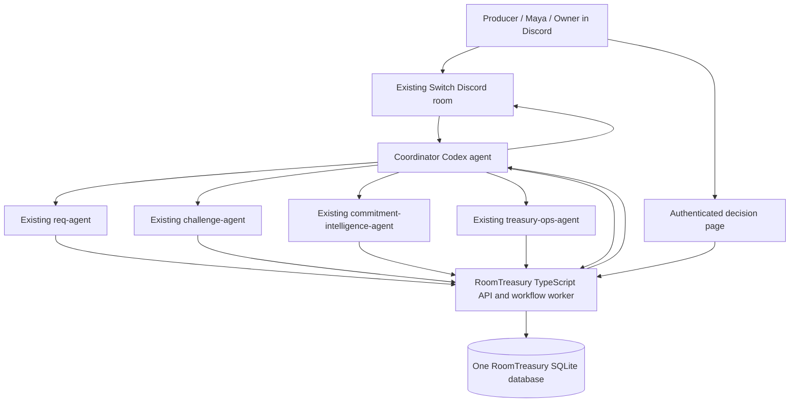

# RoomTreasury Lite: architecture review

Status: proposed for review, 2026-11-06. This deliverable is documentation only. No backend, agent configuration, Discord message, or financial feature has been implemented or tested.

## 1. Repository and environment review

- Repository starts at `7f77934` (`chore: initialize RoomTreasury repository`); working tree was clean at inspection.
- Only `README.md` and `.gitignore` were tracked. No application code, dependencies, migrations, tests, or credentials were present.
- Empty directories already exist under `agents/{coordinator,request,challenge,commitment-intelligence,treasury-ops}`, `backend/src/{security,agents,db,api,domain,services}`, `backend/tests`, `demo`, and `docs`. Preserve this structure.
- Ignore rules cover environment files (except `.env.example`), dependencies, builds, and common database extensions. Add SQLite WAL/SHM, runtime data, logs, and credential-file exclusions before implementation.
- Local tools report Node 20.20.2, npm 10.8.2, SQLite CLI 3.54.0. These observations do not establish npm driver compatibility or select the eventual supported Node runtime.
- Switch Console is running. Its UI reports four running Codex specialists and a RoomTreasury Discord connector whose `#general` room has four agents. Console screenshot reports v0.40.1; installed core source is under version 0.31.0. These are separate component versions.
- Existing agents are infrastructure outside this repository. Their prompts, permissions, financial correctness, and programmatic interoperability have not been tested by this review.

Read [Switch verification](switch-integration.md) before choosing or configuring a transport. In particular, the current deployment's main-agent feature flag and specialist addressing policies remain unverified.

## 2. Proposed architecture



One TypeScript/Node service owns all RoomTreasury state. It includes an HTTP API, durable workflow scheduler, outbox, and simulated settlement service. SQLite is the sole financial authority. Switch's existing internal PostgreSQL remains Switch infrastructure; do not migrate or write financial state into it.

The Coordinator is the user-facing interpreter and narrator. The backend is the deterministic workflow authority: it chooses eligible tasks, checks dependencies and principal capabilities, accepts validated handoffs, and executes guarded financial transitions. The Coordinator cannot skip those guards by changing a prompt.

Proposed libraries: Fastify for HTTP, a maintained SQLite driver supporting explicit transactions (candidate `better-sqlite3`), schema validation, and a TypeScript-compatible test runner. Pin compatible versions and select a supported Node runtime in milestone 1; none are installed or verified yet. Serve a small owner decision page from the same service; no separate web application is needed for this demo.

Use a single local service process and local SQLite file. Enable foreign keys, WAL, and a bounded busy timeout on every connection. Never put this database on a network filesystem. Tests must use multiple database connections to prove concurrency invariants. Agents receive scoped API access, never direct database or migration access. Existing unrestricted local Codex hosts are trusted infrastructure: API capabilities alone cannot prevent a process with filesystem access from modifying SQLite. Strong isolation requires separate OS users/process sandboxes; document the demo's trust boundary.

## 3. Financial and authorization decisions

All amounts are positive integer USD cents within an explicit safe bound (`Number.MAX_SAFE_INTEGER` or a smaller product cap). Reject floats, numeric strings, negative amounts, zero transfers, overflow, and currency mismatches. Check aggregate bounds as well as individual inputs.

For the fixed demo budget:

`available = budget - committed - reserved - spent`

`committed` means confirmed outstanding obligations; `reserved` means funds held for approved, unsettled request revisions; `spent` means simulated settlements. A suspected promise or Maya's corroboration is evidence, not a financial encumbrance. The $40 only enters committed after an authenticated project owner confirms its exact version.

An approval and its spending reservation are one atomic backend transaction. A preliminary policy pass does not reserve funds or authorize spending. At approval and settlement, re-check current revision, policy, membership, evidence clearance, and financial state. Newly discovered unresolved obligations block approval/settlement until resolved; owner confirmation of a new obligation must also fit alongside existing reservations. Never silently revoke approved holds to make a new commitment fit.

Owners authenticate through a proposed Discord OAuth2 authorization-code flow with state and a secure server session. Backend binds immutable Discord user ID to a provisioned ProjectMember role. Discord display names, guild admin status, Switch agent ownership, room text, and agent-provided `approvedBy` fields confer no financial authority. Project owner provisioning is an operator action outside agents; no public self-promotion endpoint. Verify OAuth application/callback setup during the integration milestone.

The owner opens a decision link from the Coordinator, reviews recipient, amount, purpose, currency, revision/version and evidence, then explicitly submits. GET links never mutate state. POST requires session authentication, CSRF protection, target version, and a one-use decision nonce bound to the authenticated owner and target digest. Role is checked again at action time. This preserves a single conversational entry point while making consequential decisions authenticated. Maya can corroborate through the same authenticated UI as a teammate; this never confirms the financial commitment.

Spending approval is bound to immutable request revision, recipient version, terms digest and policy version. Editing any approved term requires a new revision and new approval. Revision creation atomically supersedes the previous revision, revokes any unused approval and releases its active hold. A settled request cannot be revised or settled again through a new revision; a further payment is a new request. No actual payment-provider credentials or real settlement in Lite.

See [schema](database-schema.md) for transaction boundaries and [API](api-contract.md) for principal scopes.

## 4. Workflow and shared context

Backend stores workflow/task history and typed outputs. Room history is supporting evidence, not the task database. Every handoff carries IDs, revision/version, source references and context version. Each specialist retrieves the current authoritative snapshot before working. A stale response is retained as history but cannot advance the workflow.

Default dependency graph:

1. Request Agent structures the producer's request into a proposed immutable revision; producer identity and source are retained.
2. Challenge Agent performs an initial advisory review; backend evaluates deterministic policy rules.
3. Commitment Intelligence investigates existing obligations and paginates room history. Missing/truncated history is explicit uncertainty, never proof that no obligation exists.
4. If a possible promise appears, request teammate corroboration, then an authenticated owner confirmation or dismissal of that commitment version. Workflow waits durably; no database transaction remains open while waiting for a person.
5. Backend reruns policy against current balances and evidence. Challenge explains failure or flags remaining risks. Failed revisions cannot proceed to approval.
6. Producer may revise; the new revision gets its own review/evidence-clearance record. Prior evidence can be referenced, but its completeness and current applicability must be revalidated.
7. Owner approves the exact eligible revision; backend creates approval plus reservation atomically.
8. Treasury Ops requests simulated settlement; backend validates and converts the hold into a spend plus one receipt atomically.
9. Coordinator fetches backend balances and receipt and returns one consolidated outcome, with intermediate human-decision prompts only as needed.

Workflow states: `running`, `waiting_human`, `blocked`, `completed`, `failed`, `cancelled`. Task states: `pending`, `ready`, `leased`, `waiting_human`, `succeeded`, `failed`, `blocked`, `cancelled`. Only successful required dependencies make a task ready. Dependencies form a DAG in the same workflow. Failed tasks block dependents. Retrying creates an attempt; cancellation and supersession reject late outputs.

Use expiring leases with attempt/fencing tokens, optimistic context versions, bounded transport retries, and a durable outbox. A worker restart resumes pending work and expired leases. Financial operations rely on business uniqueness as well as idempotency keys. A room-post timeout can cause duplicate notification delivery because Switch-side deduplication is unverified; repeated task IDs must never duplicate workflow or financial effects. Track final-response delivery separately from financial completion.

## 5. Proposed final directory structure

Existing directories are retained. This is the target layout after the milestones, not a claim these files exist now.

```text
RoomTreasury/
  README.md
  .gitignore
  .env.example                  # RoomTreasury variables only; no Switch guesses
  package.json                  # workspace scripts
  package-lock.json
  tsconfig.base.json
  agents/
    coordinator/instructions.md
    request/instructions.md     # maps to existing req-agent; does not rename it
    challenge/instructions.md
    commitment-intelligence/instructions.md
    treasury-ops/instructions.md
  backend/
    package.json
    tsconfig.json
    src/
      app.ts
      server.ts
      config.ts
      api/                     # routes, validation, error mapping
      security/                # human sessions, CSRF, memberships, agent scopes
      domain/                  # cents, policies, states, transition guards
      db/
        connection.ts
        migrations/
        repositories/
      services/                # revisions, commitments, approvals, settlement
      agents/                  # handoff schemas and capability mapping
      workflows/               # dependency scheduler, leases, attempts, outbox
      integrations/switch/     # verified adapter; no financial state here
      web/                     # authenticated review and decision page
    tests/
      domain/
      financial/
      authorization/
      workflows/
      integration/
  demo/
    fixtures/                  # synthetic identities and source messages
    seed.ts
    run-scenario.ts
    README.md
  docs/
    architecture.md
    switch-integration.md
    database-schema.md
    api-contract.md
    milestones.md
  var/                         # ignored, never committed
    real/roomtreasury.sqlite
    demo/roomtreasury.sqlite
```

## 6. Review decisions and scope boundary

Review the single-backend model, authenticated decision page, approval-time reservation, immutable revisions, and conditional Switch transport. The natural-language flow requires no specialist mentions by the user; explicit mentions of other agents may bypass Switch's main-agent routing and are outside that default routing guarantee.

The preferred transport is Switch targeted room handoffs from the existing agent sessions, conditional on a live capability test. A private internal handoff room is optional if verified supported and configured later; initially handoffs remain visible in the existing room/thread. Do not promise invisible agent communication or synchronous RPC. Do not create a replacement Discord bot, replace specialists, change existing permissions, or modify Switch storage during this review.

Implementation begins only after this architecture and the integration assumptions are reviewed, per the project brief. [Milestones](milestones.md) define separate changes and acceptance gates.
